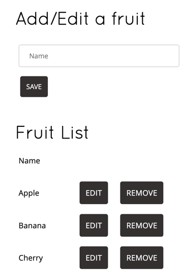

# Demo for using JeKa in conjunction with  Maven 

JeKa can be used for filling the missing features of other build tools

Here, we are using a Quarkus project built with Maven. the project is forked from https://github.com/domaframework/quarkus-sample.

This project consists in a native web app, that provides a GUI for managing a basket of fruits.



Initially, users that wanted to build and run this project with *Maven*, had to fulfill some prerequisites, as installing a proper 
Graalvm JDK and setting needed environment variables.

JeKa comes to the rescue by providing full portability: 
  - Installation of proper JDK if missing.
  - Set proper environment variables prior delegating the build to Maven

## Build and execute from anywhere

You can build and run the project, without having *JeKa*, *Maven* or any *JDK* installed on the host machine.

At the root of the project, execute:
```shell
./jeka -p
```
If the native executable is missing, JeKa builds it first, then runs it. The application listens on
[http://localhost:8080](http://localhost:8080). Any arguments passed after the `-p` option are passed as program arguments.

To build it, JeKa:
- Downloads the needed JDK (GraalVM) and JeKa version, if needed
- Sets the relevant environment variables (`JAVA_HOME`, `GRAALVM_HOME`, `PATH`)
- Executes the `mvnw clean package -Dmaven.test.skip=true -Pnative` *Maven* command, and copies the result to *jeka-output*

To only build the native executable:
```shell
./jeka maven: wrapPackage args="-Pnative"
```

## Run the application without cloning the repo

If you have JeKa installed on the host machine, the project can be executed transparently from its remote
Git repo (no need to clone manually).

```shell
jeka -r https://github.com/jeka-dev/demo-maven-jeka-quarkus.git -p
```

This command can be run from any location on the host machine. The first run takes longer because of the
native compilation. The next runs start in milliseconds.

## How it works

The whole configuration lies in [jeka.properties](jeka.properties):
- `jeka.java.version` and `jeka.java.distrib=graalvm`: the JDK, with the `native-image` tool.
- `jeka.program.build`: the command run by `-p` when the executable is missing.

## Run any Maven command

Any Maven command can be wrapped by JeKa, with the same JDK and environment variables. For example:
```shell
./jeka maven: wrap args="test"
```

## Links

- [maven KBean](https://jeka-dev.github.io/jeka/reference/kbeans-maven/)
- [Source-runnable applications](https://jeka-dev.github.io/jeka/tutorials/source-runnable-apps/)
